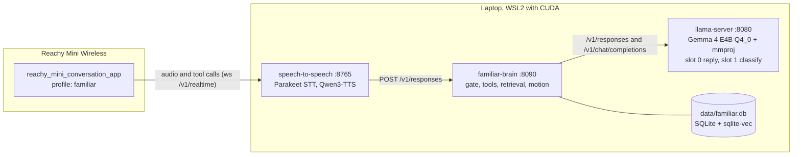

# Reachy Familiar

A local "brain" service that turns a Reachy Mini Wireless robot into a player's familiar (their character's companion creature) at an in-person D&D table. It hears the whole table, speaks only when spoken to, rolls dice through a tool, and remembers the campaign.

[](LICENSE)
[](pyproject.toml)

A robot on a game table hears everyone at once, and a stock voice assistant answers all of them. `familiar-brain` is the Flask service I wrote to change that. It sits between Pollen Robotics' unmodified conversation app (through the `speech-to-speech` realtime server) and a local `llama-server` running Gemma 4 E4B, relaying replies over the OpenAI Responses API in both directions. In between it adds what a table needs: an address gate, dice and initiative tools run in the brain, retrieval over campaign notes and the 5e SRD, session memory, and gestures chosen by the brain rather than the replying model.

The brain is built and covered by a pytest suite of 364 test functions, and it has run with the robot for one 21-minute session on 2026-09-16. Scripted live scoring and a full four-hour session are still to do.

I built it so my character's familiar in our *Shadows over Nephria* campaign could sit on the table and follow the game, with speech recognition, the language model, vision and text-to-speech all running locally.

## Highlights

- A Responses API proxy written against the installed client's source. `speech-to-speech` 1.0.0 reads exactly three stream events, needs a non-streaming reply to its startup warmup, and raises on function calls without a `call_` id ([docs/protocol-notes.md](docs/protocol-notes.md)). The brain answers both streaming and non-streaming requests, runs `roll`, `initiative`, `note`, `lookup_rule` and `recall` itself (up to 3 tool rounds), and hides their frames from the robot. Of the robot's own tools, only `camera` is still offered to the model and passed through. Gesture tools such as `play_emotion` and `head_tracking` are hidden from the model and sent by the brain itself (see the expression bullet below). [scripts/sdk_contract_probe.py](scripts/sdk_contract_probe.py) checks the contract with the same `openai` SDK the client uses.
- An address gate shaped by live failures ([familiar_brain/gate.py](familiar_brain/gate.py)). It checks, in order: mute; a Speak Now press or a naming, with rules so "a rocky outcrop" and "his name is Rocky" do not wake it and "Rocky pass me the dice" is not missed; a follow-up window anchored to the last naming and capped at 3 follow-ups; and last, a one-token classifier on a second llama-server slot that can only answer AMBIENT or IGNORE and fails to IGNORE. The first live run showed that the design's window, re-armed every time the familiar spoke, never closed (deviation E6).
- Local knowledge in SQLite with `sqlite-vec` and `BAAI/bge-small-en-v1.5` embeddings on CPU, across four corpora: SRD rules (2014 and 2024 editions, chunked by PDF bookmarks), the table's homebrew (searched first), curated campaign notes, and sessions. A session's transcript is de-duplicated and indexed by embedding alone while it runs. Afterwards it is summarised (window by window, then merged, when it is longer than 24,000 characters), scrubbed of the real player names listed in `config/players.txt`, and folded into a running campaign memory capped at 6,000 characters.
- Expression chosen by the brain rather than by the replying model. Keyword rules alone pick a reply's gesture. For lines not addressed to the familiar, keyword rules and then a one-token reaction call on the classify slot pick a reaction. Gestures come from the app's emotion intents (6 s gesture gap, 10 s reaction gap) and go out as `function_call` items ahead of any reply. Gesture calls are stripped from the history the model sees, because Gemma copied them: with them left in, 5 of 6 addressed replies were a bare `play_emotion` with no words; with them removed, 0 of 6.
- Sight through the app's own `camera` tool and Gemma 4's multimodal projector on the same `llama-server`, so there is no second vision model. Frames are never written to disk or to the session log, and a frame that arrives while muted gets no reply. This path is tested at the desk; its live probe on the robot is still to run.
- Tests that need no GPU, model or robot: an in-process fake `llama-server`, a hashed bag-of-words fake embedder, protocol fixtures captured from a live exchange, and a Hypothesis property test for dice totals. Departures from the written plans are recorded with the reason and the covering test in [docs/deviations.md](docs/deviations.md).

## Measured results

All figures come from [docs/versions.md](docs/versions.md) and [docs/deviations.md](docs/deviations.md), measured on the development laptop (Ryzen 9 7940HS, RTX 4080 Laptop GPU with 12 GB).

| What was measured | Result | Source |
|---|---|---|
| Model calls `roll` instead of inventing a number | 7 of 12 live trials before a fixed tool-use rule in the system prompt, 12 of 12 after | deviations E3 |
| Earlier three-way gate classifier, 12 labelled table lines | given the last four lines: 4 of 12, 7 uninvited replies; given the last line only: 11 of 12, none uninvited | deviations E9 |
| Addressed turn, brain-side time to first token | 9278 ms with Gemma 4's default reasoning, 183 ms with reasoning effort `none` | versions.md |
| Addressed turn, brain-side total | 9780 ms before, 620 ms after; dice turns with a tool round trip 218 to 1216 ms | versions.md |
| Gate classifier call (one token) | 286 ms before, 59 ms after | versions.md |
| VRAM with Parakeet, Gemma 4 E4B Q4_0 and Qwen3-TTS resident, measured before the mmproj was added for sight | 11540 of 12282 MiB | versions.md |
| Embedder, first embed vs warm | 11863 ms vs 21 ms, so it is loaded at startup | versions.md |
| Session with the robot, 2026-09-16, about 70 lines | 1 uninvited reply, from an 868-word segment the transcriber had merged; gate rules added for it | deviations P13 |

The turn latency rows are brain-side timings from `timing.py` over the same four turns during bring-up, so they leave out speech recognition and text-to-speech. Under full-stack GPU load on 2026-09-16 a per-reply mood call timed out on 11 of 11 addressed turns, and it was taken out of the reply path (recorded in [familiar_brain/app.py](familiar_brain/app.py)). The scripted gate and latency scoring in [docs/live-loop.md](docs/live-loop.md) has not been run yet.

## How it works

The system is three processes on one laptop plus the stock app on the robot. The robot side is configuration only: a profile in [robot_profile/familiar/](robot_profile/familiar/) and [scripts/robot_connect.py](scripts/robot_connect.py), which sets the app's connection, profile, tools and voice over the JSON-RPC socket its settings UI uses. `speech-to-speech` is pointed at the brain instead of at the model, so the brain sees every utterance and every tool result.



What happens on one request to `/v1/responses` ([familiar_brain/app.py](familiar_brain/app.py)):

1. The request is classified as a fresh utterance or a continuation: a tool result echo, a camera frame, the app's greeting, or the client compacting its history. Continuations skip the gate.
2. An utterance is corrected against [config/lexicon.tsv](config/lexicon.tsv), so setting names misheard by the transcriber ("Thraca", "Nefrea") reach the gate, the log and retrieval spelt correctly, then the gate decides ADDRESSED, AMBIENT or IGNORE.
3. A preface of robot tool calls is built: a head-tracking toggle when it changes, a pending mute or unmute cue, then a reply gesture or a reaction to the table.
4. On an ADDRESSED turn the brain retrieves up to 3 chunks per corpus (capped at 4,800 characters), renders the persona with fixed blocks a persona file cannot override (the table's off-limits topics, a rule never to speak for the DM, the dice tool rule, the sight rule, a length ceiling), and streams from slot 0. If an addressed reply comes back with no words, it asks once more with no tools offered.
5. Anything else returns just the preface, or a single `idle_do_nothing`. While a session is active and logging is on, each utterance (not continuations) is written as a JSONL session row, and every request writes a timing line to the brain log with whichever of `gate_ms`, `retrieval_ms`, `preface_ms` and `generation_ms` apply, plus `total_ms`.

The full design is in [docs/superpowers/specs/2026-09-10-reachy-familiar-design.md](docs/superpowers/specs/2026-09-10-reachy-familiar-design.md), and the plans it was built from are in [plans/](plans/).

## Tech stack

| Layer | Used here |
|---|---|
| Brain service | Python 3.11+, Flask 3, requests, PyYAML, uv with hatchling |
| Retrieval | SQLite, `sqlite-vec`, `sentence-transformers` with `BAAI/bge-small-en-v1.5` on CPU, PyMuPDF for the SRD PDFs |
| Model | llama.cpp `llama-server` with `ggml-org/gemma-4-E4B-it-GGUF:Q4_0` and its mmproj, 2 slots, 32k context |
| Voice | `speech-to-speech` 1.0.0: Parakeet-TDT 0.6B v3 for speech recognition, Qwen3-TTS 1.7B CustomVoice for speech |
| Robot | Reachy Mini Wireless running Pollen Robotics' `reachy_mini_conversation_app` |
| Tests | pytest, Hypothesis, pytest-timeout |

Exact versions, the install without sudo, and the WSL2 networking and CUDA 12 library workarounds are in [docs/versions.md](docs/versions.md).

## Getting started

### Run the tests

Needs Python 3.11+ and uv. No GPU, model server or robot.

```bash
git clone https://github.com/TirtheshJani/DnD_Familia_Reachy.git
cd DnD_Familia_Reachy
uv sync --extra dev
uv run pytest -q          # tests marked slow (they download the embedding model) are skipped by default
uv run pytest -q -m slow  # optional: load the real BGE embedder on CPU
```

### Configure and index

```bash
cp config/persona.example.yaml config/persona.yaml     # required; the shipped persona is Rocky
cp config/players.example.txt config/players.txt       # real first names to scrub from summaries; edit before use
```

Seed `data/notes/` from the setting files in `plans/` with the recipe in [docs/notes-policy.md](docs/notes-policy.md). For rules, download the SRD 5.1 and 5.2.1 PDFs into `data/rules/` (see the attribution below). Then:

```bash
uv run familiar-brain index notes
uv run familiar-brain index rules data/rules/SRD_CC_v5.1.pdf --edition 2014
uv run familiar-brain index rules data/rules/SRD_CC_v5.2.1.pdf --edition 2024
```

### Run the full stack

Inside WSL2 or Linux with an NVIDIA GPU, after installing `llama-server` and `speech-to-speech` as described in [docs/versions.md](docs/versions.md):

```bash
bash scripts/check_env.sh                     # networking, memory, CUDA, binaries, robot reachability
bash scripts/start_all.sh                     # llama-server :8080, familiar-brain :8090, speech-to-speech :8765
uv run python scripts/robot_connect.py        # point the robot's conversation app at this machine
curl -X POST http://127.0.0.1:8090/api/session/start
```

To run the brain on its own: `uv run familiar-brain serve config/brain.toml`. Ports, slots, the follow-up window, retention and gesture gaps are in [config/brain.toml](config/brain.toml). The robot checks to run before a session are in [docs/smoke-test.md](docs/smoke-test.md).

### After a session

```bash
curl -X POST http://127.0.0.1:8090/api/session/end                         # end and queue the summary
uv run familiar-brain label data/sessions/<id>.jsonl                       # mark what the gate should have decided
uv run familiar-brain gate-report data/sessions/<id>.jsonl data/brain.log  # accuracy, uninvited speech, latency
uv run familiar-brain learn                                                # summarise any unsummarised session now
```

## HTTP API

| Endpoint | Purpose |
|---|---|
| `POST /v1/responses` | Responses API for `speech-to-speech`, streaming and non-streaming |
| `GET /api/state` | mute, mode, tracking, logging, session id, recent lines |
| `POST /api/mute`, `/api/unmute`, `/api/mute_and_stop_logging` | privacy controls, each with a gesture cue |
| `POST /api/speak_now` | treat the next line as addressed |
| `POST /api/mode` | switch between `familiar` and `thinking` reply modes |
| `POST /api/note` | add a deliberate note to the session log |
| `POST /api/session/start`, `/api/session/end`, `DELETE /api/session/<id>` | session lifecycle and purge |
| `POST /api/learn`, `POST /api/reindex`, `GET /api/sessions` | catch-up summaries, notes reindex, session listing |

## Repository layout

```text
familiar_brain/            the Flask service
  app.py                   /v1/responses and the /api routes
  gate.py                  address gate
  upstream.py              llama-server proxy and brain-side tool rounds
  responses_api.py         Responses API events and request shapes
  persona.py               system prompt and fixed blocks
  motion.py, attention.py  gestures, reactions, head tracking
  retrieval.py, knowledge.py, chunking.py, indexing.py
  live_index.py, transcript.py, summariser.py, campaign.py, learning.py
  llm.py, lexicon.py, modes.py, state.py, session.py, timing.py, cli.py, config.py
  tools/                   roll, initiative, note, lookup_rule, recall
config/                    brain.toml, persona.example.yaml, lexicon.tsv, players.example.txt
robot_profile/familiar/    conversation app profile
scripts/                   start_all.sh, check_env.sh, robot_connect.py, sdk_contract_probe.py, capture_protocol.py
tests/                     35 test files, fakes/ and fixtures/
docs/                      versions and measurements, deviations, protocol notes, smoke test, live loop, notes policy
plans/                     design, plans 1 to 3, and the campaign setting files 00 to 10
```

`data/` is gitignored. It holds the vector store, session logs and service logs, which are created at runtime, and the notes and SRD PDFs you add by hand.

## Campaign notes policy

`data/notes/` is what the familiar remembers, and only curated fiction plus the table's homebrew rules may go in it. Recordings, anything about the people at the table, and player names stay out. See [docs/notes-policy.md](docs/notes-policy.md).

## Status and roadmap

Everything above is built and tested at the desk. Four things have also been verified on the hardware: the full stack running on the laptop, the SDK contract probe, live dice turns whose spoken totals matched the tool, and one session with the robot.

Still to do:

- Run the scripted live loop in [docs/live-loop.md](docs/live-loop.md) and record `gate-report` accuracy, uninvited speech and latency.
- Run the Plan 3 robot probes in [docs/smoke-test.md](docs/smoke-test.md) (reactions, sight, reading dice by camera, thinking mode) and record them in `docs/versions.md`.
- Run live indexing, windowed summaries and the campaign memory (deviations P17 to P19) in the live stack. They are covered by tests but have not run there yet, and the summariser has not been run on a real transcript.
- Build the phone companion UI from design section 4.6. The mute, Speak Now, note, session and state endpoints it would call exist; the UI itself is not in the repo.
- "Deep night" (the familiar goes still on the DM's cue) is deferred until it has been discussed with the Dungeon Master.
- Run a full four-hour session, the design's success criterion.

## Relation to rocky_mini

The shipped persona is called Rocky, a name taken from my earlier `rocky_mini` project on the same robot. Only the name carries over: none of that project's code, voice or memory is used here (Plan 3, decision D1).

## Acknowledgements

Built on [Reachy Mini](https://github.com/pollen-robotics/reachy_mini) and the [conversation app](https://github.com/pollen-robotics/reachy_mini_conversation_app) by Pollen Robotics, the `speech-to-speech` package, llama.cpp, and the open model weights listed in [docs/versions.md](docs/versions.md).

## Rules attribution

This work includes material from the System Reference Document 5.1 and 5.2.1 ("SRD 5.1", "SRD 5.2.1") by Wizards of the Coast LLC, available at https://www.dndbeyond.com/srd. The SRDs are licensed under the Creative Commons Attribution 4.0 International License, available at https://creativecommons.org/licenses/by/4.0/legalcode.

The PDFs are not redistributed here. Download them into `data/rules/` and index them with the commands under "Configure and index".

## Author

Tirthesh Jani · [GitHub](https://github.com/TirtheshJani) · [LinkedIn](https://www.linkedin.com/in/tirthesh-jani)

## License

MIT. See [LICENSE](LICENSE).
